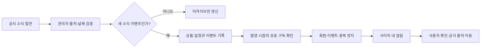

# Figure Alert & Catalog — 성과 중심 진행 기준

작성일: 2026-10-13. 사용자 제공 인수인계와 멘토링 메모를 통합한다. 기존 알림 정책은 유지한다. 이 문서의 목표 수치·일정·비용은 제안 또는 계산 가정이며 실제 성과가 아니다.

2026-10-15 사용자 확정: 첫 배포는 카탈로그 조회·회원/인증·캐릭터 구독·내부 알림 V1에 집중한다. 기존 제안 일정과 다르면 이 범위를 우선한다. 위시리스트·리뷰·개별 피규어 구독은 후속 범위로 유지한다. 최신 진행 상태는 [PROGRESS.md](PROGRESS.md), 일일 기록은 [scrum](scrum/README.md)에서 관리한다. 테스트·트랜잭션·권한·필요한 동시성은 각 기능에서 검증하고, 성능 개선은 측정된 필요에 따라 진행한다.

## 1. 왜 만드는가

출발점은 판매가 끝난 피규어 정보를 다시 찾기 어렵다는 개인적인 경험이다. 이를 음성합성 캐릭터 수집가가 공식 발표·예약·재발매 정보를 여러 곳에서 확인해야 하는 문제로 확장한다. 개인 경험을 시장 전체의 수요로 단정하지 않는다.

검증할 가설: 한국어로 관심 캐릭터의 공식 일정과 출처를 한곳에서 확인하면 정보 탐색 부담과 예약 누락을 줄일 수 있다. 대상 사용자의 기존 확인 방식, 실제 누락 경험, 반복 사용 여부로 판단한다.

성과를 반드시 성공으로 만들 수는 없다. 대신 모든 작업에 질문, 기준선, 결과, 다음 결정을 남긴다. 수요가 낮다는 결과도 범위를 줄이거나 중단하는 근거가 된다. 실패를 매출·사용자 성과로 포장하지 않는다.

## 2. 시장과 대안 — 확인 사실과 가설 구분

2026-10-13 공개 페이지 조사:

| 대안 | 확인한 제공 가치 | 우리 서비스의 검증 질문 |
|---|---|---|
| [MyFigureCollection](https://myfigurecollection.net/) | 피규어 등 수집품 DB와 컬렉션 관리 | 이미 사용하는 사람이 한국어·공식 일정 중심 경험을 추가로 필요로 하는가? |
| [MFC 도움말](https://myfigurecollection.net/about/faq/) | 좋아하는 캐릭터의 신규 피규어 DB 추가 알림에 관한 항목 존재 | 캐릭터 알림 자체가 아니라 출처·이벤트 구분·예약 일정에서 차이가 있는가? |
| [Good Smile 공식몰](https://www.goodsmile.com/en/lp-a-3) | 상품·예약 정보와 뉴스레터 | 제조사별 확인보다 통합 확인이 시간을 줄이는가? |
| [Good Smile 예약 마감 달력](https://www.goodsmile.com/en/calendar-preorder) | 예약 마감 안내 | 관심 캐릭터만 추리는 것이 유용한가? |

기존 서비스에 관련 기능이 없다고 주장하지 않는다. 한국어 수요, 한국 이용자 규모, 유료 전환 의사는 미검증이다. 시장 규모와 경쟁사의 모든 기능을 조사 완료했다고 표현하지 않는다.

초기 조사: 대상 수집가 5~8명에게 최근 3개월의 정보 확인 방식, 놓친 사례, 주간 확인 시간, 사용하는 대안, 가장 필요한 이벤트를 묻는다. 인터뷰 결과를 익명으로 기록하고 실제 행동과 희망 사항을 구분한다. 연락·게시·홍보는 별도 실행 요청이 있을 때 진행한다.

## 3. 고객 페르소나와 시나리오

다음은 인터뷰 전 가설 페르소나다.

- 수집가: 미쿠·테토 신제품을 정기적으로 확인한다. 관련 없는 상품 소식을 줄이고 공식 예약 일정을 알고 싶다.
- 입문자: 원하는 과거 상품과 재발매 여부를 찾는다. 예약·발매·프라이즈 등장 날짜의 차이가 어렵다.
- 운영자: 공식 제조사 정보를 확인해 등록한다. 오래된 상품 추가가 신규 발표 알림으로 나가지 않아야 한다.

핵심 시나리오: 공개 카탈로그 탐색 → 상품과 공식 출처 확인 → 로그인 → 캐릭터와 알림 종류 선택 → 새로운 검증 이벤트의 사이트 내 알림 확인 → 공식 페이지 이동.

사이트 내 알림만으로는 접속하지 않는 사람의 예약 누락 방지 효과를 입증하기 어렵다. 먼저 정보 탐색과 알림 정확성을 검증하고, 외부 전달 수단의 필요성은 사용자 관찰로 판단한다.

## 4. 목표와 측정

출시일은 배포 완료 후 확정한다. 가입자는 중복·테스트 계정을 제외한 신규 계정이다. 활성 사용자는 해당 기간에 카탈로그 상세 조회 또는 알림 조회를 한 사용자다.

| 시점 | 제안 목표 | 측정 및 판단 |
|---|---|---|
| 배포 전 2주 | 제조사 2곳, 상품 10~20개로 운영 실험 | 수집 대상과 확인 기록을 고정하고 누락·오류·등록 지연 측정 |
| 출시 후 4주 | 실제 테스트 사용자 10명, 그중 5명 이상 2개 이상의 서로 다른 주에 핵심 행동 | 활동 로그와 사용자 의견을 함께 확인; 모집 실패와 재사용 실패 구분 |
| 출시 후 3개월 | 핵심 행동 월 활성 사용자 30명 | 실제 이벤트 발생 빈도를 고려해 재방문 이유 분석 |
| 출시 후 1년 | 누적 신규 가입자 100명, 월 활성 사용자 30명 | 사업성 입증 수치가 아니라 초기 검증 목표; 4주 결과로 수정 |

품질 목표: 검증 이벤트의 공식 출처 기록률 100%, 같은 이벤트의 회원별 중복 알림 0건, 틀린 일정 알림 0건. 관측 건수와 기간을 반드시 함께 기록한다. 0건은 미래 무오류 보장이 아니다.

측정 정의:

- 정보 확보율 = 등록한 검증 대상 이벤트 / 별도 공식 출처 감사로 발견한 대상 이벤트. 발견하지 못한 전체 시장 이벤트를 분모로 추정하지 않는다.
- 등록 지연 = 공식 발표 시각부터 등록 시각까지. 공식 발표 시각이 불명확하면 확인 시각 기준 지연으로 별도 기록한다.
- 활성화율 = 가입 후 7일 내 캐릭터 구독 완료자 / 7일 관찰이 끝난 가입자.
- 알림 조회율 = 조회한 알림 / 생성한 알림. 생성과 조회는 외부 발송 성공과 다르다.
- 탐색 시간 = 동일 과제의 기존 방식과 서비스 사용 시간 비교. 참여자 수·과제·측정 조건을 기록한다.

매주 결과표: 기간 / 가설 / 작업 / 기준선 / 관측값·표본 / 사용자 의견 / 비용·투입시간 / 유지·수정·중단 결정. 이벤트가 없던 기간은 효과 검증 미완료로 표시한다.

## 5. 사용자 확보에 투자할 기준

개발만 해서는 반복 사용을 확인할 수 없다. 먼저 사용 가능한 핵심 흐름을 배포하고 소규모 이용 관찰에 시간을 투자한다. 홍보 규모 자체는 목표로 삼지 않는다. 초기에는 주당 2시간을 모집·관찰·피드백 분석에 배정하는 안을 사용한다.

4주마다 판단한다: 모집이 안 되면 대상·접근 경로를 검토하고, 가입만 하면 첫 구독 흐름을 검토하며, 구독 후 재사용이 없으면 소식 빈도·정보 가치·전달 방식을 검토한다. 유용성 검증 전에는 유료 광고 확대를 보류한다.

가입자 수만으로 개발시간의 본전을 계산할 수 없다. 수익 없는 무료 사용자 1만 명도 현금 손익분기를 보장하지 않는다. 취업 포트폴리오 가치는 사용자 피드백, 정합성 검증, 설계 설명, 실제 협업 증거로 별도 평가한다.

## 6. 비용과 손익 계산

‘한달에 300’은 단위와 의미가 불명확하다. 월 매출 300만 원인지, 예산인지, 사용자 300명인지 확정하기 전 목표로 고정하지 않는다.

아래 금액은 가격 견적이 아닌 계산 예시다. AWS 구성·리전·운영시간·환율과 AI 모델을 선택한 후 공식 요금표 또는 청구 내역으로 교체한다.

| 항목 | 계산 예시 가정 |
|---|---|
| 월 AWS 비용 | 50,000원: 컴퓨팅·DB·저장·전송·로그·백업 포함 여부를 실제 견적에서 확인 |
| 월 AI 비용 | 20,000원: 개발 보조와 서비스 운영 사용량을 분리 |
| 월 기타 현금 비용 | 10,000원: 도메인 월 환산 등 |
| 월 현금 비용 F | 80,000원 |
| 월 투입시간 H와 시간가치 W | 40시간 × 20,000원 = 800,000원 |
| 초기 개발 투자 D | 200시간 × 20,000원 = 4,000,000원 |
| 유료 사용자당 월 공헌이익 m | 3,000원: 매출에서 수수료·환불·사용자당 변동비 차감 후라는 가정 |

현금 손익분기 유료 사용자 = 올림(F / m) = 27명.
시간비용 포함 손익분기 = 올림((F + H×W) / m) = 294명.
초기 개발비를 12개월에 회수할 목표 = 올림((F + H×W + D/12) / m) = 405명.

유료 전환율이 5%라고 가정하면 필요한 활성 사용자는 각각 540명, 5,880명, 8,100명이다. 전환율은 측정 전 가정이며 위 목표는 유료 상품을 실제로 만든다는 결정이 아니다. 변동비가 규모에 따라 변하면 다시 계산한다. 매출 300만 원도 이익 300만 원과 다르다.

AI 비용 기록: 모델 / 용도 / 입력·캐시·출력 토큰 / 각 백만 토큰 단가 / 환율 / 과세·수수료 / 실제 청구액. 입력·출력별 사용 토큰을 1,000,000으로 나누어 해당 단가를 곱한다. 정액 구독은 API 토큰 과금과 분리한다. 현재 서비스에 AI 추론 기능을 추가해야 한다는 요구는 없다.

## 7. 기술 선택 — A보다 B를 택한 이유

기술의 우열이 아니라 이 요구사항에서의 판단을 설명한다. 아래 중 기존 사용 기술의 근거는 검토안이며 당시 실제 결정 이력으로 단정하지 않는다.

| A안 | B안 / 현재 방향 | 선택 이유와 한계 |
|---|---|---|
| 생성·변경 API 분리 | PUT으로 구독 생성·설정 교체 통합 | 하나의 설정 저장 흐름, 반복 요청의 최종 상태 일치. 동시 생성 충돌은 별도 처리 필요 |
| 앱의 존재 조회만 사용 | DB 회원·캐릭터 UNIQUE와 트랜잭션 | 동시 요청에도 중복 행 차단. 제약 위반 후 재처리는 트랜잭션 경계를 검토해야 함 |
| 비트마스크·설정 테이블 | 알림 5종 Boolean | 명시적 의미와 쉬운 설명. 종류가 빈번히 늘면 재검토 |
| 여러 서비스·분산 트랜잭션 | 단일 Spring 애플리케이션·MySQL 로컬 트랜잭션 | 초기 운영 규모와 관계형 정합성에 맞음. 외부 발송은 DB 트랜잭션만으로 원자성을 보장 못함 |
| 즉시 자동 수집·발송 | 공식 정보 관리자 확인 | 잘못된 날짜·과거 상품 신규 알림 방지. 수작업 시간과 누락 측정 필요 |
| 일정마다 메모리 타이머 등록 | DB의 대상 일정을 주기적으로 조회하는 안 | 일정 변경·재시작 후 재평가 용이. 주기 지연·중복 실행 고려; 구현 전 최종 선택 |

Java 21·Spring·JPA·MySQL은 기존 코드 재사용과 백엔드 포트폴리오 목적에 맞춰 유지한다. JPA는 관계 매핑에 편리하지만 쿼리와 지연 로딩을 직접 검증한다. Security는 본인 구독과 관리자 수정 권한을 검증한다. 빌드에 Spring Boot 4.1.1이 선언되어 있다는 사실과 실제 빌드 성공은 구분한다.

분산 트랜잭션, Redis, Kafka는 학습 키워드만으로 도입하지 않는다. 외부 발송이 추가되면 DB 저장과 발송 사이의 실패를 먼저 재현하고 outbox·재시도 등의 대안을 비교한다.

## 8. 설계 산출물과 화면 연결

화면 코드는 설계용 제안이며 현재 프런트엔드가 존재한다는 뜻이 아니다.

| 화면 | 메뉴 / 기능 | 설계 산출물 |
|---|---|---|
| CAT-01 | 카탈로그 검색 | 검색 조건·페이지 정책 |
| CAT-02 | 상품 상세·발매 이력·공식 출처 | Figure/Release ERD와 날짜 의미 |
| SUB-01 | 내 캐릭터 구독 설정 | 변수 정의서·PUT 시퀀스·권한 |
| NTF-01 | 내 알림 | 이벤트 식별·중복 방지·조회 정책 |
| ADM-01 | 공식 정보 검증·등록 | 검증 기록·이벤트 발행 흐름 |

메뉴 구조: 공개 카탈로그(검색, 상세) / 계정(회원가입, 로그인) / 내 서비스(구독 설정, 알림) / 관리자(정보 등록·검증). 위시리스트·리뷰는 후속 우선순위로 보존한다.

특성요인 분석: 예약 누락의 원인 후보를 정보(출처 분산·날짜 의미 혼동), 사용자(소식 과다·접속 빈도), 운영(등록 지연·오입력), 시스템(중복 실행·일정 변경·구독 충돌)으로 나눈다. 원인 후보는 확정 원인이 아니다. 원인별로 필요한 데이터·검증·화면을 연결한다.

변수 정의서 작성 규칙: 화면 코드 / API·엔티티 / 변수명 / 한글명 / Java·DB 타입 / 형식·길이 / 필수·기본값 / 출처·검증 / 구현 여부를 기록한다. 화면 표시값과 DB 값은 구분하고 실제 매핑을 확인한다.

| 화면 | 변수명 | 한글명 | 타입·형식·길이 | 검증 / 현재 상태 |
|---|---|---|---|---|
| SUB-01 | characterId | 캐릭터 식별자 | Java Long / DB BIGINT 매핑 확인, 양의 정수 | 존재·권한 확인; 연관관계 구현 |
| SUB-01 | announcementEnabled 등 5개 | 종류별 알림 수신 | Boolean 제안, 문자열 길이 없음 | 전체 설정 교체·누락 처리 결정 필요; 미구현 |
| SUB-01 | createdAt | 구독 생성 시각 | LocalDateTime, 저장 정밀도·시간대 정책 확인 | 현재 생성 시 자동 기록 |
| ADM-01 / CAT-02 | sourceUrl | 공식 출처 | String 제안, 길이·허용 형식 미정 | 공식 출처 검증; 미구현 |
| ADM-01 | verifiedAt | 공식 확인 시각 | 시각 타입·시간대 정책 미정 | 운영 감사 기준; 미구현 |
| CAT-02 | preorderDeadline | 공식 예약 마감 | 날짜 또는 시각 정책 미정 | 제조사 공식몰 적용 범위 표시; 미구현 |

ERD와 시퀀스는 코드 변경 시 함께 갱신한다. 현재 Release는 발매 연·월·일과 유형·상태를 가진다. 예약 마감 필드가 있다고 가정하지 않는다. FigureSubscription·Notification도 현재 파일 목록에서 확인되지 않았다.

PUT 시퀀스의 필수 분기: 인증 → 캐릭터 확인 → 기존 구독 조회 → 생성 또는 설정 교체 → 저장 → 201 또는 200. 동시 생성 UNIQUE 충돌, 인증 실패, 없는 캐릭터, 재요청을 별도로 표시한다. 일정 처리 시퀀스에는 일정 변경·재실행·구독 취소·발송 실패를 포함한다.

## 9. 일정과 역할 — 제안 6주

| 기간 | 작업 | 완료 기준 |
|---|---|---|
| 1주 | 문제 인터뷰·수집 실험 시작·현재 코드와 요구사항 비교 | 가설·관측 대상·구독 변경 범위 문서 |
| 2주 | 구독 PUT·권한·동시성 처리 | 반복 요청·설정 교체·경쟁 생성 검증 |
| 3주 | 검증 이벤트·사이트 알림 | 과거 등록 무알림·다중 구독 중복 방지 |
| 4주 | 예약 마감 일정·변경·재실행 | 미확인 날짜 무알림·중복 방지 검증 |
| 5주 | 배포·로그·비용·README | 핵심 흐름 이용 가능·실제 비용 기록 |
| 6주 | 초기 사용자 관찰·첫 개선 | 관측 결과와 개선 전후 비교 |

구현 진척과 투입 가능 시간에 따라 조정한다. 출시 후 4주 평가는 위 6주 일정 이후에도 이어간다.

현재 역할: 본인=기획·개발·운영·최종 판단, AI=초안·대안·검증 보조. 실제 협업 상대는 아직 확보되지 않았다. 현업자 README 리뷰는 문서 이해도 검증이고, 팀 개발 경험과 동일하게 쓰지 않는다. 공동 개발을 한다면 실제 맡은 이슈, PR 리뷰, 의견 차이와 결정, 인터페이스 합의, 일정 조정의 증거를 남긴다. AI 사용을 사람과의 협업 경험으로 대체하지 않는다.

## 10. AI 검증과 설명 가능성

1. 변경 전 요구사항·수용 기준·대상 파일·대안 비교를 먼저 작성한다.
2. 결과를 현재 코드와 대조한다. 요청하지 않은 기능, 새로운 계층·인터페이스, 불필요한 추상화, 의존성을 확인한다.
3. 보안·데이터 무결성·실패 분기를 직접 검토하고 요구사항에 맞는 테스트를 실행한다.
4. 변경 코드에서 무작위 연속 10줄을 여러 곳 뽑아 각 줄의 목적·트랜잭션 경계·SQL 영향·실패 행동을 설명한다. 설명하지 못하면 채택 전 학습·단순화한다.
5. 무작위 설명만으로 검증을 끝내지 않는다. 인증, 제약조건, 일정 계산, 재시도는 전부 검토한다.
6. 실행 환경·명령·결과·남은 한계를 기록한다. AI의 ‘통과’ 주장만으로 테스트 성공을 기록하지 않는다.

## 11. 다음 구현 전 결정과 확인된 차이

현재 CharacterSubscription은 회원·캐릭터 UNIQUE가 있고, Service는 기존 구독에 예외를 던진다. 알림 5종 필드·설정 변경 메서드·구독 Controller/DTO는 확인되지 않았다. 이 문서 작성에서는 기능 코드를 변경하거나 테스트하지 않았다.

확정 정책 1 — 전체 알림 끄기: 다섯 종류를 모두 끄더라도 구독 행은 유지한다. 구독은 관심 캐릭터를 저장하는 의미도 가진다. 화면에 ‘구독 중 · 알림 꺼짐’을 표시하고, 구독 취소는 별도 동작으로 제공한다. 최소 한 종류를 강제하는 A안보다 일시적으로 알림을 쉬고 다시 켜기 편한 B안을 선택했다. 사용자가 2026-10-13 확정했으며 아직 구현 전이다.

확정 정책 2 — 동시 생성 충돌: 사용자 재시도를 요구하는 A안 대신 서버가 기존 구독에 설정을 갱신하는 B안을 선택했다. 사용자 불편을 줄이는 대신 개발자가 기록과 검증을 책임진다. 같은 회원·캐릭터 UNIQUE 제약으로 발생한 생성 충돌만 식별해 새 트랜잭션에서 재처리한다. 실제 저장 완료 후에만 성공 응답하며, 다른 DB 오류나 재처리 실패는 저장 실패로 처리한다. 요청 식별자로 충돌·재처리 결과를 연결해 기록하되 비밀값은 남기지 않는다. 서로 다른 설정이 경쟁하면 마지막으로 반영된 갱신이 남으며, 사용자 클릭 순서를 보장하지 않는다. 독립 트랜잭션의 동시 생성, 같은 설정 반복, 서로 다른 설정 경쟁, 재처리 실패를 검증한다. 이탈 감소는 미검증 가설이며 배포 후 저장 실패율·재시도 횟수·구독 완료율로 확인한다. 사용자가 2026-10-13 확정했으며 아직 구현 전이다.

확정 정책 3 — 구독 직후 마감 임박: 새 캐릭터 구독에서 예약 마감 알림을 선택한 경우, 공식 예약 마감이 확인되고 아직 마감되지 않은 3일 이내 상품을 한 번 안내하는 B안을 선택했다. 현재 행동할 수 있는 예약을 놓치지 않도록 ‘과거 이벤트 소급 없음’ 원칙의 명시적 예외로 둔다. 공식몰의 마감 적용 대상과 출처를 표시하고, 반복 PUT·동시 생성 재처리·스케줄러와 겹쳐도 같은 회원·마감 이벤트의 알림을 중복 생성하지 않는다. 전체 알림을 끈 구독에는 생성하지 않는다. 기존 구독에서 마감 알림을 다시 켜는 경우까지 적용할지는 아직 확정하지 않았다. 사용자가 2026-10-13 확정했으며 아직 구현 전이다.

확정 정책 4 — 공식 예약 마감 변경: 기존 알림의 변경 표시만 제공하는 A안 대신, 기존 알림을 최신 정보로 갱신하고 변경 알림을 한 번 제공하는 B안을 선택했다. 이미 안내한 날짜를 믿고 예약을 놓칠 위험을 줄이는 것이 선택 이유다. 관리자가 공식 출처로 실제 변경을 확인한 후 처리한다. 변경 알림 대상은 해당 일정의 알림을 이미 받은 사용자 중 현재 구독이 유효하고 마감 알림을 켠 사용자다. 기존 수신자라도 구독 취소·마감 알림 해제 후에는 새 변경 알림을 생성하지 않는다. 이전 날짜·새 날짜·적용 대상·공식 출처를 확인할 수 있게 한다. 동일 변경의 반복 저장·재처리·스케줄러 재실행은 추가 알림을 만들지 않는다. 아직 알림을 받지 않은 사용자는 새 일정으로 마감 알림을 재계산한다. 일정 변경 안내는 마감 알림 설정에 포함하며 여섯 번째 사용자 선택 항목을 추가하지 않는다. 이후 같은 새 일정의 마감 임박 알림과 변경 알림의 통합 여부, 날짜가 다시 변경되는 경우의 변경 식별 방법은 구현 전 구체화한다. 사용자가 2026-10-13 확정했으며 아직 구현 전이다.

확정 정책 5 — 프라이즈 등장 예정 알림: 등장 직전 일정에 맞추는 A안 대신, 관리자가 공식 등장 예정 정보를 확인한 시점에 한 번 안내하는 B안을 선택했다. 정확한 날짜 없이 월만 공개된 경우에도 확인된 소식을 전달할 수 있다는 것이 선택 이유다. ‘11월 예정’처럼 공식 정보의 정밀도를 그대로 표시하고 임의의 날짜를 만들지 않는다. 현재 유효한 구독에서 프라이즈 알림을 선택한 사용자에게 이후 발생한 검증 이벤트를 전달하며, 과거 아카이브 등록만으로 새 알림을 만들지 않는다. 동일 이벤트의 재등록·재처리에는 중복 알림을 생성하지 않는다. 등장 직전 추가 안내와 예정 정보 변경 알림은 이번 결정에 포함하지 않는다. 사용자가 2026-10-13 확정했으며 아직 구현 전이다.

다섯 가지 기본 정책의 선택은 완료했다. 구현 전에는 마감의 날짜·시각 및 시간대, 기존 구독의 마감 알림 재활성화, 변경 알림과 새 일정의 마감 임박 알림 통합 여부, 일정 변경 식별 방법을 구체화한다. 선택 확정과 구현·검증 완료를 구분한다.

README 리뷰 질문: 3분 내 대상 사용자와 해결 문제를 설명할 수 있는가? 구현·계획·실측 성과가 구분되는가? 왜 PUT·UNIQUE를 선택했는가? 실행에 필요한 환경·설정이 명확한가? 실패 사례와 검증 근거를 찾을 수 있는가? 실제 리뷰 일자·익명 역할·피드백·반영 PR을 기록한다.

성과 서술 양식: ‘사용자가 [문제]를 겪어 A와 B를 비교했다. [조건] 때문에 B를 선택했고, [기간·표본·방법]으로 검증해 [실측 결과]를 얻었다. [한계]가 있어 다음에는 [개선]을 진행한다.’ 측정 전에는 결과 부분을 비워 둔다.
